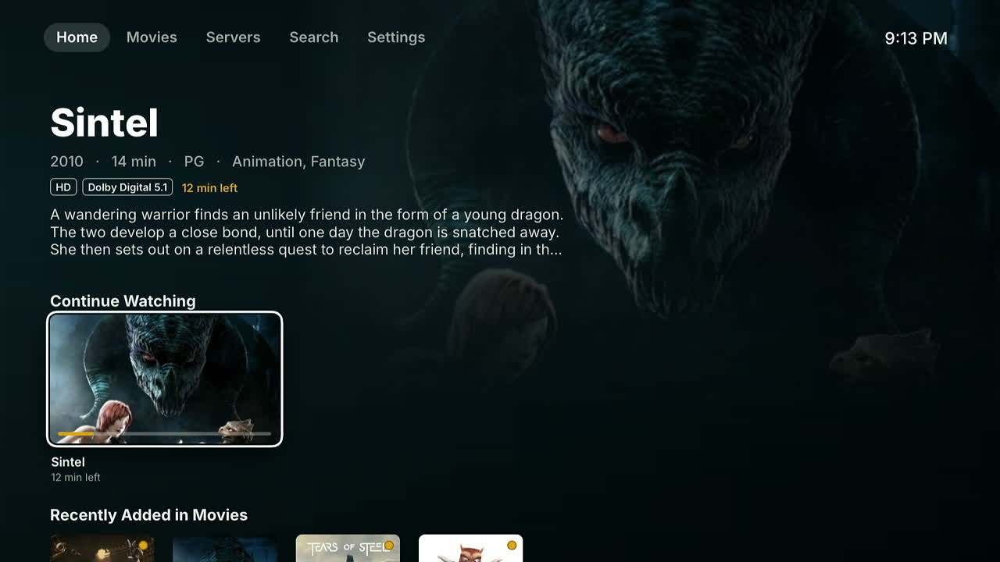
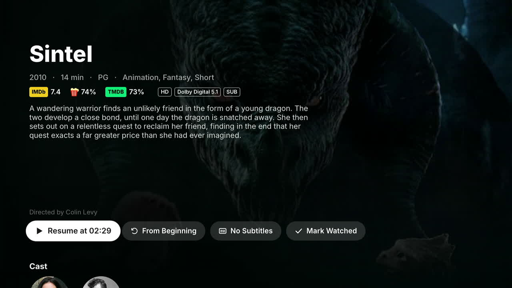
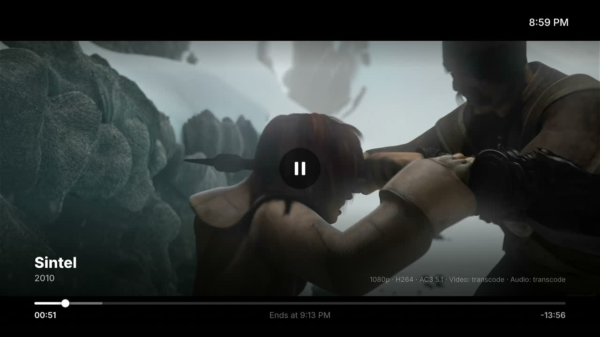
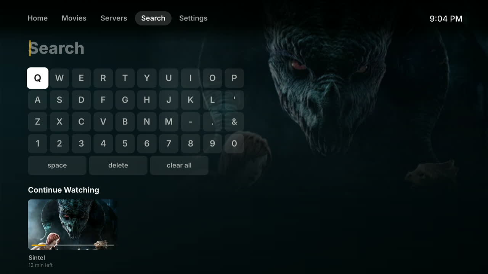
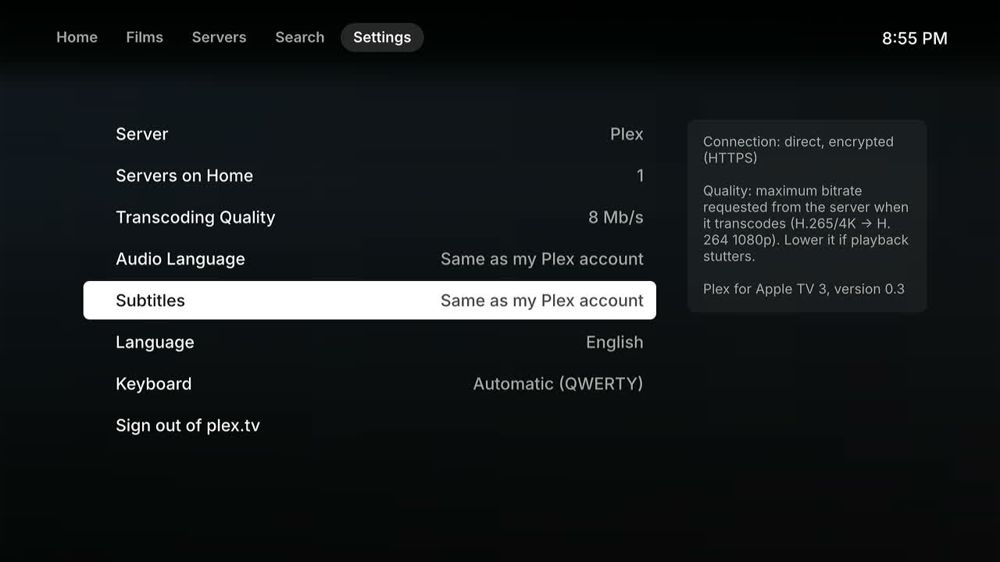

# PlexATV3

A native Plex client for the **Apple TV 3** (A1427 / A1469, Apple TV Software 7.x,
iOS 8.4 underneath), running as an app on the Apple TV home screen.

> Unofficial project, not affiliated with or endorsed by Plex, Inc.

The Apple TV 3 never had a Plex app. The usual workaround, PlexConnect, needs
a computer running next to it and hijacks the Trailers app. PlexATV3 is a real
app instead. It is written in Objective-C against the private BackRow
framework that drives the Apple TV interface. It talks to your Plex servers
directly and plays video with the device's hardware H.264 decoder.



| | |
|---|---|
|  |  |
|  |  |

<sub>Screenshots taken on an Apple TV 3 with a demo library of Blender open movies
(Sintel, Big Buck Bunny, Tears of Steel, Elephants Dream; CC BY, Blender Foundation).</sub>

## Features

**Account and servers**
- plex.tv sign-in with a PIN (plex.tv/link).
- All the servers of your account, owned and shared, over local, remote
  (plex.direct HTTPS) and relay connections. You choose which servers feed
  the home screen.
- A Servers tab to browse one server at a time.

**Browsing**
- Home with hubs (continue watching, on deck, recently added) merged across
  servers, tvOS-style tabs and a live hero for the focused item.
- Library grids with sort and filters. Libraries of unmatched videos (home
  videos, recordings) switch to 16:9 cards.
- Movie, show, season and episode pages: ratings (IMDb, Rotten Tomatoes,
  TMDB), cast and crew, technical badges, similar titles.
- Unified search across servers, with suggestions before you type.
- Top Shelf on the Apple TV home screen (continue watching).

**Playback**
- Hardware H.264 + AAC direct play. Everything else (HEVC, 4K, HDR, AC-3,
  DTS, TrueHD, bitmap subtitles…) is converted by the Plex server to
  H.264 1080p + AAC over HLS.
- Version choice (4K / 1080p / editions) and "play from another server"
  for titles available on several servers.
- Resume points, watched state and timeline synced with the server.
- Audio and subtitle track choice, preferred languages.
- Chapters, skip intro / credits, next episode, scrub preview thumbnails.
- Bitrate setting, volume on the remote's up / down keys.

**Languages**
- Interface in English and French, following the Apple TV language or set
  in Settings. On-screen keyboard in AZERTY, QWERTY or QWERTZ.

What is done, planned or impossible on this hardware is tracked in
[docs/PARITY.md](docs/PARITY.md): Plex Home users, collections, playlists,
music, photos, casting from the phone, Live TV…

## Hardware limits

| Apple TV 3 | Consequence |
|---|---|
| H.264 decoder only, 1080p30 | Other codecs, 4K and 60 fps are transcoded by the server: you need a server that can transcode. |
| No HDR output | HDR sources need tone mapping on the server. |
| AC-3 stalls the system player | AC-3, E-AC-3, DTS and TrueHD tracks are converted to AAC by the server. No passthrough. |
| iOS 8 TLS stack | plex.tv online services (Discover, watchlist, Live TV guide) are not reachable yet. Your own servers work. |
| A5 CPU, 512 MB RAM | The UI is built on Core Animation, with text and images rendered off the main thread, recycled cells and caches. It runs at 50 to 60 fps on the device. |

## Requirements

- An Apple TV 3 on software 7.x, jailbroken, with an appliance loader for
  third-party `.frappliance` bundles (beigelist), and SSH access.
- A Plex Media Server, ideally able to transcode (see above).

## Install

Each [release](https://github.com/huguesdelamure/PlexATV3/releases) comes
with the app already built: no Mac or Xcode needed. Download
`PlexATV3-<version>.tar.gz`, then:

```sh
scp PlexATV3-<version>.tar.gz root@<apple-tv>:/tmp/
ssh root@<apple-tv> 'cd /Applications/AppleTV.app/Appliances && rm -rf PlexATV3.frappliance && tar -xzf /tmp/PlexATV3-<version>.tar.gz && chown -R root:wheel PlexATV3.frappliance && killall AppleTV'
```

The app appears on the home screen as "Plex". On first launch it shows a
code to enter at plex.tv/link, then the list of your servers.

Update: same commands with the new archive. Uninstall:

```sh
ssh root@<apple-tv> 'rm -rf /Applications/AppleTV.app/Appliances/PlexATV3.frappliance; killall AppleTV'
```

## Build from source

Only needed to modify the app. You need a Mac with:

- a current Xcode (its clang compiles armv7 fine);
- from the Xcode 6.4 dmg: `iPhoneOS8.4.sdk` and the toolchain's
  `usr/bin/ld`, copied to `../toolchain/iPhoneOS8.4.sdk` and
  `../toolchain/bin/ld64-242`. Recent linkers produce armv7 binaries that
  crash in the iOS 8 dyld. ld64-242 runs under Rosetta. Override the
  location with `make TOOLCHAIN=/path`;
- `ldid` (Homebrew).

```sh
make RELEASE=1                        # release build (make alone: debug build)
echo "ATV_HOST=192.168.1.20" > .env   # Apple TV address
echo "ATV_SSH_KEY=~/.ssh/atv" >> .env # optional, key auth recommended
make deploy                           # copies the bundle and restarts the Apple TV UI
```

Releases: bump `CFBundleShortVersionString` in `App/Resources/Info.plist`,
add a section to [CHANGELOG.md](CHANGELOG.md), commit, then
`scripts/release.sh <version>` (build and checks) and
`scripts/release.sh <version> --publish` (tag and GitHub release).

## Project layout

- `Kit/`: reusable foundation, independent of Plex.
  - BackRow bridge: the AppleTV binary does not export the BackRow classes,
    so every subclass is created at runtime.
  - Core Animation UI toolkit (shelves, grids, lists, focus, async text).
  - Image cache, fonts, settings, localization, debug channel.
  - Other appliances can embed it. Build with `-DKIT_PREFIX_LK` to avoid
    Objective-C class name clashes in the shared AppleTV process.
- `App/`: the Plex client.
  - `Plex/`: plex.tv, servers, items, playback decisions.
  - `Screens/`: home, libraries, detail pages, search, player, settings.
  - `UI/`: Plex-specific layers (posters, cast row, keyboard layouts).
  - `Resources/`: Info.plist, icons, translations.
- `scripts/`: deploy, SSH and debug helpers.
- `tools/`: icon sources.

## Development

`make` without `RELEASE=1` builds a debug version with a development
channel. The app polls a command file on the Apple TV, and
`scripts/atv-cmd.sh` appends to it:

```sh
scripts/atv-cmd.sh tap right        # remote keys: up down left right select menu menuhold
scripts/atv-cmd.sh fpsmeter         # log frame rate while navigating
scripts/atv-cmd.sh stallwatch on 50 # sample the main thread stack on stalls > 50 ms
scripts/atv-cmd.sh servers          # list servers and connection state
```

Logs go to `/var/mobile/Library/Caches/PlexATV3/plexatv.log` on the Apple
TV. Stall samples print image + offset. Symbolize them with
`atos -arch armv7 -o build/PlexATV3.frappliance/PlexATV3 -l 0x0 <offset>`.

`scripts/atv-lock.sh` takes a lock on the device, so that two people
deploying to the same Apple TV do not break each other's test.
`scripts/deploy.sh` takes it automatically.

Things worth knowing:

- Do not add UIViews to a BackRow controller. BackRow walks the subviews
  and expects BRControls. Everything here is CALayers.
- On armv7, calling a method that returns a struct (CGRect, CGSize…)
  through a plain `objc_msgSend` crashes. Use `objc_msgSend_stret` or a
  typed cast.
- A crash inside an appliance makes the Apple TV UI restart in a loop.
  Remove the bundle over SSH to recover.
- On iOS 8, a CATextLayer given a font *name* rescans the font files on
  every change. Pass a CGFont.

## Adding a language

Texts are written in French in the code and wrapped in `PXL(@"…")` or
`PXLF(@"…", …)`. The French text is the translation key.

1. Copy `App/Resources/en.lproj/Localizable.strings` to
   `App/Resources/<code>.lproj/` and translate the right-hand side. Keep
   `%@`, `%ld`… in the same order.
2. Add the code to `PXSupportedLanguages()` and its name to
   `PXLanguageName()` in `Kit/Core/PXLocalize.m`.
3. Optionally, map the language to a keyboard layout in
   `App/UI/PXKeyboard.h`.

## How it was written

- App code: Claude Opus 5.5
- Reverse engineering: Mistral Large 4 🥖

## Contributing

See [CONTRIBUTING.md](CONTRIBUTING.md).

## License

MIT, see [LICENSE](LICENSE). The Inter font (`Kit/Resources/Fonts`) is under
the SIL Open Font License, see `Inter-LICENSE.txt`.

Plex and the Plex logo are trademarks of Plex, Inc. They are used here only
to identify the service this client connects to.
